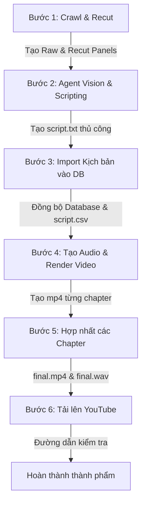

# 🤖 Manga Recap System Skill (Quy trình chuẩn hóa)

Hành động này hướng dẫn Agent và Nhà phát triển thực hiện quy trình tự động hóa sản xuất video Manga Recap. 
Quy trình này ép buộc một **Workflow chuẩn hóa 6 bước (với Bước 6 là tùy chọn)**, trong đó các bước phân tích hình ảnh (VLM) và viết kịch bản (LLM) bắt buộc phải do chính **Agent (AI)** thực hiện thủ công thông qua việc quan sát ảnh trực tiếp và viết kịch bản, không chạy API tự động để đảm bảo tính tự nhiên và chất lượng cao nhất cho video thành phẩm.

---

## 📋 Tham Số Cấu Hình Hệ Thống (Configuration & Defaults)

Khi bắt đầu một dự án Manga Recap, cần xác định các tham số sau:
1. **Chapter Number**: Số chương cần xử lý (ví dụ: `1`, `2`, `3`).
2. **Project Title**: Tên dự án trong cơ sở dữ liệu (ví dụ: `Warrior Grandpa And His Supreme Granddaughter`).
3. **Project Slug**: Tên thư mục slug viết thường, không dấu cách (ví dụ: `warrior_grandpa_and_his_supreme_granddaughter`).
4. **Voice Model**: Tên giọng đọc thuyết minh Cloud API:
   - `edge-tts-female` (Mặc định: Giọng nữ Hoài My - Microsoft Neural API)
   - `edge-tts-male` (Giọng nam Nam Minh - Microsoft Neural API)
   - `gemini-2.5-flash` (Giọng Google Gemini Audio API)
   - `openai-tts-nova` / `openai-tts-alloy` (Giọng OpenAI Cloud TTS)
5. **Video Mode**: Chế độ khung hình:
   - `auto` (Mặc định: Tự động phát hiện dựa trên ảnh đầu tiên)
   - `portrait_padded` (Pad mờ hai bên cho ảnh dọc/vuông)
   - `landscape_fit` (Khớp khung hình 16:9)
   - `portrait_vertical` (Trượt từ trên xuống dưới cho webtoon strip dài)
6. **Speed**: Tốc độ đọc (mặc định: `1.0`).

---

## 🔄 Workflow Chuẩn Hóa (Workflow with Optional Step 6)



---

## 🛠️ Hướng Dẫn Chi Tiết Từng Bước

### BƯỚC 1: CRAWL & PHÂN CẢNH (CRAWL & RECUT)
Dùng CLI `crawler_cli.py` để tải ảnh thô từ URL và cắt phân cảnh thành các panel riêng biệt.

* **Công cụ sử dụng**: `src/cli/crawler_cli.py`
* **Tham số đầu vào (Inputs)**:
  * `--chapter`: Số chapter (bắt buộc)
  * `--url`: URL trang web chứa chapter cần crawl (bắt buộc)
  * `--project`: Tên dự án (bắt buộc)
  * `--max-panels`: Số lượng panel tối đa cần cắt (tùy chọn)
* **Kết quả đầu ra (Outputs)**:
  * Ảnh gốc lưu tại: `data/[PROJECT_SLUG]/image/raw/chap_[CHAPTER_NUMBER]/`
  * Các panel cắt nhỏ lưu tại: `data/[PROJECT_SLUG]/image/recut/chap_[CHAPTER_NUMBER]/panel_001.jpg` đến `panel_XXX.jpg`
  * Đăng ký chapter và panels vào bảng `chapters` và `panels` trong Supabase với trạng thái mặc định `processing`/`pending`.
* **Lệnh thực hiện**:
  ```bash
  PYTHONPATH=. venv/bin/python src/cli/crawler_cli.py --chapter [CHAPTER_NUMBER] --project "[PROJECT_TITLE]" --url "[CHAPTER_URL]"
  ```

---

### BƯỚC 2: AGENT VISION & SCRIPTING (PHÂN TÍCH ẢNH & VIẾT KỊCH BẢN)
**Bắt buộc thực hiện bởi Agent (AI) trong cửa sổ chat.** Agent phải trực tiếp mở các panel hình ảnh bằng công cụ `view_file` để tự mình phân tích và biên kịch.

#### 1. Đọc bộ nhớ dài hạn:
* Đọc file `data/[PROJECT_SLUG]/memory/character_dictionary.json` (nếu có) để nhận diện đặc điểm ngoại hình, tên gọi của nhân vật nhằm đảm bảo tính đồng nhất cốt truyện.

#### 2. Cơ chế xử lý phân đoạn và gối đầu (Batching 5 panels, Overlap 2 panels):
* **Cơ chế tải ảnh**: Đọc và phân tích ảnh theo nhóm **5 khung hình** mỗi lượt (ví dụ lượt 1 xem Khung 1-5).
* **Quy tắc gối đầu (Overlap)**:
  * Chỉ viết kịch bản cho **3 khung hình đầu tiên** trong nhóm 5 ảnh.
  * Giữ lại **2 khung hình cuối** để làm gối đầu (overlap) cho lượt phân tích tiếp theo (lượt tiếp theo sẽ xem từ Khung 4 đến Khung 8, trong đó Khung 4-5 là ảnh cũ từ lượt trước làm bối cảnh tương lai gần, Khung 6-8 là ảnh mới).
  * Việc overlap 2 ảnh giúp Agent nắm bắt được dòng chảy nội dung của tương lai gần (lookahead) để liên kết kịch bản mượt mà nhất.
  * Với đợt cuối cùng của chapter, hãy viết kịch bản cho toàn bộ các khung hình còn lại.
* Gọi công cụ `view_file` cho từng ảnh trong nhóm 5 khung hình để xem diễn biến thực tế.
* **Cấu trúc phân tích thị giác (Input)**:
  * Đọc lời thoại gốc (OCR) trong các bong bóng thoại.
  * Phân tích hành động, biểu cảm khuôn mặt của nhân vật và cảnh nền.
* **Cấu trúc kịch bản (Output)**:
  * **QUY TẮC LỜI THOẠI TRỰC TIẾP**: Lời thoại của nhân vật phải được viết trực tiếp bên trong dấu ngoặc kép (ví dụ: Diệp Chung Minh kinh ngạc: "Mình đã quay về quá khứ sao?").
  * **QUY TẮC MÔ TẢ**: Phần mô tả bên ngoài dấu ngoặc kép chỉ dành để kể về hành động, ngoại hình hoặc bối cảnh xung quanh của nhân vật. Tuyệt đối KHÔNG sử dụng mô tả gián tiếp để thuật lại lời nói (như "Diệp Chung Minh kinh ngạc thốt lên mình đã quay về quá khứ sao").
  * **QUY TẮC ĐỘ DÀI**: Mỗi khung hình chỉ giới hạn từ 1 đến 2 câu thuyết minh/lời thoại.
  * **Ví dụ mẫu**:
    * *Sai (Mô tả gián tiếp, thuật lại lời thoại)*: "[Khung hình 1]: Diệp Chung Minh bất ngờ bật dậy trong căn phòng cũ của mình. Anh kinh ngạc thốt lên mình đã chết rồi mà tại sao lại nằm ở đây, không lẽ mình đã quay về quá khứ sao."
    * *Đúng (Thoại trực tiếp + Mô tả hành động/bối cảnh rõ ràng)*: "[Khung hình 1]: Diệp Chung Minh kinh ngạc bật dậy trong căn phòng cũ, tự sờ lên mặt mình kiểm tra. 'Mình đã chết rồi mà? Tại sao lại nằm ở đây? Không lẽ... mình đã trùng sinh quay về quá khứ sao?'"
    * "[Khung hình 2]: Anh vội vàng nhìn lên tờ lịch treo tường năm 2013 và bàng hoàng nhận ra bản thân thực sự đã quay về thời điểm 10 năm trước, ngay trước khi mạt thế bắt đầu. 'Không được phí hoài thời gian, mình phải chuẩn bị ngay lập tức!'"

#### 3. Định dạng và lưu trữ:
* Viết toàn bộ nội dung kịch bản cho chapter đó dưới dạng text chuẩn vào file:
  `data/[PROJECT_SLUG]/image/recut/chap_[CHAPTER_NUMBER]/script.txt`
* **Định dạng file kịch bản**:
  ```
  [Khung hình 1]: <1-2 câu thuyết minh tiếng Việt mượt mà chứa đầy đủ nhân vật, bối cảnh, hành động, biểu cảm, lời thoại>
  [Khung hình 2]: <1-2 câu thuyết minh tiếng Việt mượt mà chứa đầy đủ nhân vật, bối cảnh, hành động, biểu cảm, lời thoại>
  ...
  ```
* Nếu xuất hiện nhân vật mới hoặc trang phục mới, hãy cập nhật thông tin mô tả vào `data/[PROJECT_SLUG]/memory/character_dictionary.json` dưới dạng JSON.

---

### BƯỚC 3: ĐỒNG BỘ KỊCH BẢN VÀO CƠ SỞ DỮ LIỆU
Dùng CLI `import_agent_script.py` để nạp kịch bản dạng text từ `script.txt` vào Supabase, chuyển trạng thái các panel sang `processed` và đồng bộ vào file tổng hợp `script.csv`.

* **Công cụ sử dụng**: `src/cli/import_agent_script.py`
* **Tham số đầu vào (Inputs)**:
  * `--chapter`: Số chapter (bắt buộc)
  * `--project`: Tên dự án (bắt buộc)
  * `--script`: Đường dẫn file kịch bản (tùy chọn, mặc định tự tìm `script.txt` của chapter)
* **Kết quả đầu ra (Outputs)**:
  * Cập nhật cột `status = 'processed'` cho toàn bộ các panel trong bảng `panels` của chapter.
  * Xóa các phân đoạn cũ và nạp bản ghi kịch bản mới vào bảng `script_segments` trong Supabase.
  * Đồng bộ và cập nhật kịch bản vào file `data/[PROJECT_SLUG]/memory/script.csv`.
  * Cập nhật trạng thái chapter trong bảng `chapters` thành `scripted`.
* **Lệnh thực hiện**:
  ```bash
  PYTHONPATH=. venv/bin/python src/cli/import_agent_script.py --chapter [CHAPTER_NUMBER] --project "[PROJECT_TITLE]"
  ```

---

### BƯỚC 4: RENDER GIỌNG ĐỌC & KẾT XUẤT VIDEO (RENDER)
Dùng CLI `run_recap.py` để tổng hợp giọng đọc thuyết minh tiếng Việt (TTS) cho từng panel, sau đó ghép nối ảnh và âm thanh thành video hoàn chỉnh của chapter.

* **Công cụ sử dụng**: `src/cli/run_recap.py`
* **Tham số đầu vào (Inputs)**:
  * `--chapter`: Số chapter (bắt buộc)
  * `--project`: Tên dự án (bắt buộc)
  * `--voice`: Tên giọng đọc TTS (tùy chọn, mặc định lấy từ config hoặc `edge-tts-female`)
  * `--speed`: Tốc độ giọng đọc (tùy chọn, mặc định `1.0`)
  * `--video-mode`: Chế độ hiển thị video `auto`, `portrait_padded`, `landscape_fit`, `portrait_vertical` (mặc định: `auto`)
  * `--suffix`: Hậu tố tên video (mặc định: `final_agent`)
  * `--bgm`: Đường dẫn file nhạc nền `.mp3`/`.wav` (tùy chọn)
  * `--no-subs`: Không chèn phụ đề cứng lên video (mặc định luôn bật phụ đề)
  * `--keep_temp`: Giữ lại các tệp âm thanh và hình ảnh tạm thời (tùy chọn)
* **Kết quả đầu ra (Outputs)**:
  * Âm thanh thuyết minh hoàn chỉnh của chapter lưu tại: `data/[PROJECT_SLUG]/audio/chapters/chapter_[CHAPTER_NUMBER].wav`
  * Video hoàn chỉnh của chapter kèm phụ đề lưu tại: `data/[PROJECT_SLUG]/video/chapters/chapter_[CHAPTER_NUMBER]_[SUFFIX].mp4`
* **Cảnh báo nghiệp vụ**: Lệnh này sẽ tự động báo lỗi ngay lập tức nếu chưa hoàn thành Bước 2 và Bước 3 (nếu panels chưa ở trạng thái `processed` hoặc thiếu `script_segments` trong cơ sở dữ liệu).
* **Lệnh thực hiện**:
  ```bash
  PYTHONPATH=. venv/bin/python src/cli/run_recap.py --chapter [CHAPTER_NUMBER] --project "[PROJECT_TITLE]" --voice "edge-tts-female" --video-mode auto --suffix final_agent
  ```

---

### BƯỚC 5: GHÉP NỐI TOÀN BỘ CÁC CHAPTER (COMPILATION)
Sau khi đã kết xuất xong video cho các chapter riêng lẻ, dùng CLI `compile_chapters.py` để ghép nối tất cả thành một tập recap dài hoàn chỉnh.

* **Công cụ sử dụng**: `src/cli/compile_chapters.py`
* **Tham số đầu vào (Inputs)**:
  * `--project`: Tên dự án (bắt buộc)
* **Kết quả đầu ra (Outputs)**:
  * Video tổng hợp cuối cùng lưu tại: `data/[PROJECT_SLUG]/video/final.mp4`
  * Âm thanh tổng hợp cuối cùng lưu tại: `data/[PROJECT_SLUG]/audio/final.wav`
* **Lệnh thực hiện**:
  ```bash
  PYTHONPATH=. venv/bin/python src/cli/compile_chapters.py --project "[PROJECT_TITLE]"
  ```

---

### BƯỚC 6: UPLOAD YOUTUBE (TÙY CHỌN - YOUTUBE VIDEO UPLOAD)
Sau khi video final được xuất thành công, uploader có thể đẩy thẳng video lên YouTube thông qua API v3. Bước này là tùy chọn và Agent phải hỏi lại ý kiến người dùng trước khi thực hiện.

* **Công cụ sử dụng**: `src/cli/youtube_uploader.py`
* **Tham số đầu vào (Inputs)**:
  * `--video`: Đường dẫn tới file video cần upload (bắt buộc)
  * `--title`: Tiêu đề video (bắt buộc)
  * `--description`: Mô tả chi tiết video (tùy chọn)
  * `--privacy`: Trạng thái hiển thị `public`, `private`, `unlisted` (mặc định: `unlisted`)
  * `--category`: ID phân loại danh mục của YouTube (mặc định: `24` - Entertainment)
  * `--tags`: Các từ khóa/thẻ tag ngăn cách bằng dấu phẩy (tùy chọn)
* **Kết quả đầu ra (Outputs)**:
  * Upload video lên kênh YouTube được cấu hình.
  * In ra đường dẫn URL để kiểm tra dạng: `https://www.youtube.com/watch?v=VIDEO_ID`.
* **Cơ chế xác thực (Authentication)**:
  * Yêu cầu file `client_secrets.json` đặt tại thư mục gốc của dự án.
  * Lần chạy đầu tiên sẽ mở trình duyệt để xác thực OAuth2 và lưu token vào `.youtube_token.json`. các lần sau sẽ tự động refresh token từ file này.
* **Lệnh thực hiện**:
  ```bash
  PYTHONPATH=. venv/bin/python src/cli/youtube_uploader.py --video data/[PROJECT_SLUG]/video/final.mp4 --title "[TIÊU ĐỀ VIDEO]" --description "[MÔ TẢ]" --privacy unlisted
  ```

---

## 🚫 Quy Định Nghiêm Ngặt Cho Agent
1. **Tuyệt đối không dùng các script gọi API ngoài (như Gemini hay OpenRouter) để phân tích ảnh hoặc sinh kịch bản.** Mọi việc phân tích hình ảnh và viết kịch bản tiếng Việt phải được thực hiện trực tiếp bởi tư duy và khả năng ngôn ngữ của chính Agent trong phiên chat này.
2. **Tuân thủ đúng quy trình**: Luôn chạy bước crawl trước, sau đó tự viết kịch bản và ghi vào file `script.txt`, tiếp theo chạy lệnh import kịch bản, rồi mới chạy lệnh kết xuất video. Không bao giờ chạy lệnh kết xuất video khi chưa hoàn thành bước import kịch bản.
